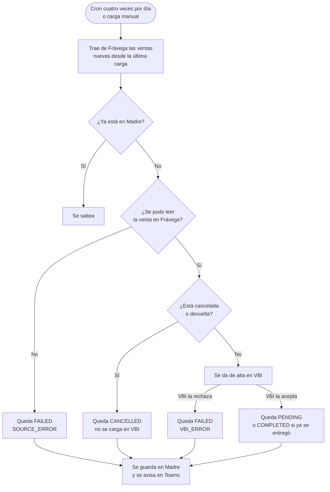

# Order API

Microservicio interno de **Tienda Lo Quiero Acá** que carga en VBI las ventas de Frávega y muestra las ventas de los marketplaces al panel.

Varias veces por día trae las ventas nuevas de Frávega, las da de alta en VBI y las guarda en Madre con el resultado. Después sigue cada venta hasta que Frávega la entrega o la cancela. Cada venta nueva se avisa en un canal de Teams, y las que no se pudieron cargar quedan registradas con el motivo.

## Qué hace

| | |
|---|---|
| **Carga de ventas en VBI** | Da de alta en VBI cada venta nueva de Frávega, con el comprador, el producto, el precio y la entrega. |
| **Seguimiento** | Revisa las ventas abiertas y las cierra cuando Frávega las entrega o las cancela. Completa el número TLQV cuando VBI lo asigna. |
| **Registro en Madre** | Cada venta queda en Madre con su estado y lo que respondió VBI, para no cargarla dos veces. |
| **Avisos en Teams** | Publica cada venta nueva en un canal de Teams y marca las que no entraron o entraron con datos incompletos. |
| **Consultas para el panel** | Devuelve las ventas de Frávega, Megatone y OnCity de un período, para panel.market. |

## Cómo funciona



El detalle de cada paso está en la [guía funcional](docs/funcional.md).

## Ambientes

| Ambiente | URL base |
|---|---|
| Producción | `https://order.api.loquieroaca.com` |
| Local | `http://localhost:3000` |

Además de los endpoints, el servicio publica dos herramientas:

| Herramienta | Ruta | Para qué |
|---|---|---|
| Documentación | `/docs` | Esta documentación, navegable y con buscador. |
| Swagger | `/api/docs` | Probar los endpoints desde el navegador (botón **Authorize** para la clave). |

## Autenticación

Las consultas (`GET /orders/...`) no piden clave: son las que usa panel.market.

Los procesos (`POST /orders/fravega/...`) piden este header:

| Header | Valor |
|---|---|
| `x-api-key` | La clave del servicio (`API_KEY`). |

Sin el header, o con una clave incorrecta, la respuesta es `401 API key invalida o ausente`. Si el servidor no tiene `API_KEY` configurada, todos los procesos responden `500 API key no configurada en el servidor`.

## Primer llamado

Las consultas son de solo lectura y no cambian nada. Es la forma segura de empezar:

```bash
curl -s "https://order.api.loquieroaca.com/orders/overview/last-24-hours"
```

Devuelve las ventas de las últimas 24 horas de los tres marketplaces, con un total por marketplace.

Los procesos, en cambio, **dan de alta ventas reales en VBI**. Ver [Referencia de la API](docs/api.md) antes de llamarlos.

## Documentación

**Órdenes**

| Documento | Qué explica |
|---|---|
| [Guía funcional](docs/funcional.md) | Cómo se carga una venta de Frávega en VBI: de dónde sale cada dato, qué se manda, estados, seguimiento, número TLQV, avisos en Teams y consultas del panel. |
| [Bloqueos](docs/bloqueos.md) | Motivos por los que una venta no entra a VBI o entra incompleta, qué significa cada uno y qué hacer. |

**API**

| Documento | Qué explica |
|---|---|
| [Referencia de la API](docs/api.md) | Todos los endpoints: consultas para el panel y procesos de Frávega, con parámetros, ejemplos, respuestas y errores. |

**Técnico**

| Documento | Qué explica |
|---|---|
| [Arquitectura y configuración](docs/tecnico.md) | Capas del código, integraciones, crons, la ventana de cada carga, variables de entorno, tests y limitaciones conocidas. |
| [Operación](docs/operacion.md) | Dónde corre, deploy, credenciales, cómo verificar que está sano y qué hacer ante los problemas más frecuentes. |

## Desarrollo local

Requisitos: Node.js 20 y acceso de red a marketplace-api y Madre.

```bash
npm install
# crear .env con las variables de docs/tecnico.md (Variables de entorno)
npm run start:dev       # http://localhost:3000
```

> **Cuidado con los crons en local.** Si `ORDERS_SYNC_CRON_ENABLED` y `ORDERS_STATUS_CRON_ENABLED` no están en `false`, los crons corren solos. Con `POWERAPPS_API_URL` cargada, eso da de alta ventas reales en VBI y escribe en Madre. En local conviene dejarlos en `false` y dejar `POWERAPPS_API_URL` vacía salvo que se quiera probar la carga.

```bash
npm test                # tests unitarios
npm run lint            # eslint con --fix
npm run build           # compila a dist/
```

Para ver la documentación como sitio, sin levantar el resto del servicio:

```bash
npm run docs:preview    # http://localhost:4310/docs
```

## Stack

NestJS 11 · TypeScript · `@nestjs/schedule` para los crons · `fetch` de Node · Jest. Corre en Kubernetes (DigitalOcean) y se deploya solo al mergear a `main`.
